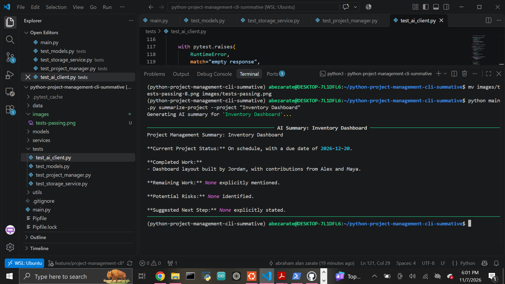
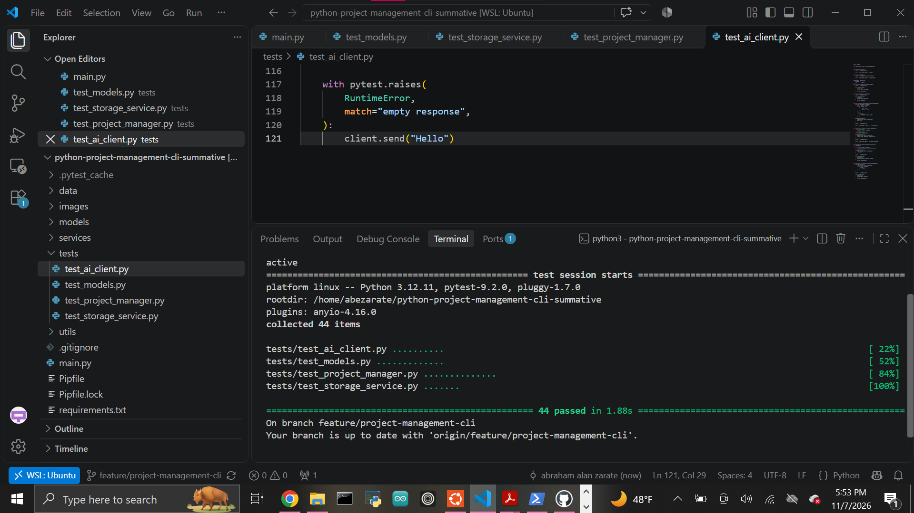

# Project Management CLI

A modular Python command-line application for managing users, projects, tasks, contributors, persistent JSON data, and AI-assisted project summaries.

The application demonstrates object-oriented programming, inheritance, encapsulation, relationships between objects, command-line argument parsing, file persistence, external Python packages, automated testing, and local AI integration with Ollama.

## Features

The CLI supports:

- Creating and listing users
- Creating, updating, and listing projects
- Creating, updating, completing, and listing tasks
- Assigning tasks to users
- Adding multiple contributors to tasks
- Saving application data to JSON
- Restoring users, projects, and tasks between CLI sessions
- Generating AI-assisted project summaries
- Formatted terminal output using Rich
- Graceful validation and service-error handling

## Object-Oriented Design

The application uses three main domain models:

```text
User
 └── Project
      └── Task
```

A `User` can own multiple `Project` objects.

A `Project` can contain multiple `Task` objects.

A `Task` can have:

- a primary assignee,
- a status,
- and multiple contributors.

All three models inherit shared ID and validation behavior from `BaseEntity`.

### BaseEntity

`models/base.py`

Provides:

- unique integer IDs,
- shared text validation,
- reusable base behavior for domain objects.

### User

`models/user.py`

Represents a user who owns projects.

Important behavior includes:

- validated names and email addresses,
- adding projects,
- locating projects,
- JSON serialization and reconstruction.

### Project

`models/project.py`

Represents a project containing tasks.

Important behavior includes:

- title, description, and due-date properties,
- adding tasks,
- locating tasks,
- completing tasks,
- JSON serialization and reconstruction.

### Task

`models/task.py`

Represents an individual project task.

Important behavior includes:

- validated task titles,
- `pending` and `completed` statuses,
- optional primary assignee,
- multiple contributors,
- completion behavior,
- JSON serialization and reconstruction.

## Architecture

The application separates responsibilities across multiple layers:

```text
Terminal
   ↓
main.py / argparse
   ↓
ProjectManager
   ├── Models
   │    ├── User
   │    ├── Project
   │    └── Task
   │
   ├── StorageService
   │       ↓
   │   JSON file
   │
   └── OllamaAIClient
           ↓
        Ollama
```

### CLI Layer

`main.py`

Responsible for:

- defining `argparse` commands,
- parsing terminal input,
- routing commands,
- displaying readable success and error messages.

The CLI does not directly manipulate the JSON file or call `ollama.chat()`.

### Business Logic Layer

`services/project_manager.py`

`ProjectManager` coordinates:

- users,
- projects,
- tasks,
- contributors,
- persistence,
- and AI summaries.

This keeps application behavior out of the CLI entry point.

### Persistence Layer

`services/storage_service.py`

`StorageService` handles:

- loading JSON data,
- saving JSON data,
- reconstructing nested Python objects,
- missing files,
- malformed JSON,
- invalid JSON structure,
- and filesystem errors.

### AI Service Layer

`services/ai_client.py`

`OllamaAIClient` is a reusable service client responsible for:

- configurable model names,
- validating prompts,
- calling `ollama.chat()`,
- extracting assistant responses,
- supporting dictionary-style and object-style responses,
- handling connection/service failures,
- rejecting empty AI responses.

The default model is:

```text
llama3.2
```

## External Packages

This project uses two external Python packages.

### Rich

Rich is used to display readable terminal tables and formatted CLI messages.

Examples include:

- user tables,
- project tables,
- task tables,
- success messages,
- error messages,
- AI summary output.

### Ollama

The `ollama` Python package communicates with a locally running Ollama service.

Structured project and task information is converted into an AI prompt and sent through the reusable `OllamaAIClient`.

The prompt asks for:

1. Current project status
2. Completed work
3. Remaining work
4. Potential risks
5. Suggested next step

The model is instructed not to invent unsupported project information.

## Project Structure

```text
python-project-management-cli-summative/
├── data/
│   └── project_data.json
├── images/
│   ├── ai-summary.png
│   └── tests-passing.png
├── models/
│   ├── __init__.py
│   ├── base.py
│   ├── project.py
│   ├── task.py
│   └── user.py
├── services/
│   ├── __init__.py
│   ├── ai_client.py
│   ├── project_manager.py
│   └── storage_service.py
├── tests/
│   ├── test_ai_client.py
│   ├── test_models.py
│   ├── test_project_manager.py
│   └── test_storage_service.py
├── utils/
│   ├── __init__.py
│   └── formatters.py
├── .gitignore
├── main.py
├── Pipfile
├── Pipfile.lock
├── requirements.txt
└── README.md
```

## Requirements

This project was developed with:

```text
Python 3.12.11
```

The project requires Python 3.10 or newer.

Runtime dependencies are managed with Pipenv.

## Installation

Clone the repository:

```bash
git clone git@github.com:Abraham-z14/python-project-management-cli-summative.git
cd python-project-management-cli-summative
```

Install the project dependencies:

```bash
pipenv install --dev
```

Enter the virtual environment:

```bash
pipenv shell
```

Verify Python:

```bash
python --version
```

## CLI Usage

View all commands:

```bash
python main.py --help
```

Available commands:

```text
add-user
list-users
add-project
update-project
list-projects
add-task
update-task
complete-task
add-contributor
list-tasks
summarize-project
```

## User Commands

Create a user:

```bash
python main.py add-user \
  --name "Jordan" \
  --email "jordan@example.com"
```

List users:

```bash
python main.py list-users
```

## Project Commands

Create a project:

```bash
python main.py add-project \
  --user "Jordan" \
  --title "Inventory Dashboard" \
  --description "Build an internal inventory tracking dashboard" \
  --due-date "2026-12-15"
```

List all projects:

```bash
python main.py list-projects
```

List projects belonging to one user:

```bash
python main.py list-projects --user "Jordan"
```

Update a project:

```bash
python main.py update-project \
  --project "Inventory Dashboard" \
  --description "Build and test an internal inventory tracking dashboard" \
  --due-date "2026-12-20"
```

A project title can also be changed:

```bash
python main.py update-project \
  --project "Inventory Dashboard" \
  --new-title "Inventory Management Dashboard"
```

## Task Commands

Create a task:

```bash
python main.py add-task \
  --project "Inventory Dashboard" \
  --title "Create dashboard layout" \
  --assigned-to "Jordan"
```

Multiple contributors may be supplied when creating a task:

```bash
python main.py add-task \
  --project "Inventory Dashboard" \
  --title "Test dashboard" \
  --assigned-to "Jordan" \
  --contributor "Alex" \
  --contributor "Maya"
```

List project tasks:

```bash
python main.py list-tasks \
  --project "Inventory Dashboard"
```

Update a task:

```bash
python main.py update-task \
  --project "Inventory Dashboard" \
  --task "Create dashboard layout" \
  --new-title "Build dashboard layout"
```

Update a task assignment or status:

```bash
python main.py update-task \
  --project "Inventory Dashboard" \
  --task "Build dashboard layout" \
  --assigned-to "Jordan" \
  --status completed
```

Complete a task:

```bash
python main.py complete-task \
  --project "Inventory Dashboard" \
  --task "Build dashboard layout"
```

Add another contributor:

```bash
python main.py add-contributor \
  --project "Inventory Dashboard" \
  --task "Build dashboard layout" \
  --name "Maya"
```

## JSON Persistence

Application data is stored in:

```text
data/project_data.json
```

The data is nested so relationships are preserved:

```text
users
 └── projects
      └── tasks
```

Every successful create or update operation is saved automatically.

A later CLI invocation reloads the JSON file and reconstructs the appropriate `User`, `Project`, and `Task` objects.

Example structure:

```json
{
    "users": [
        {
            "id": 1,
            "name": "Example User",
            "email": "user@example.com",
            "projects": [
                {
                    "id": 1,
                    "title": "Example Project",
                    "description": "Example description",
                    "due_date": "2026-12-20",
                    "tasks": [
                        {
                            "id": 1,
                            "title": "Example Task",
                            "assigned_to": "Example User",
                            "status": "pending",
                            "contributors": []
                        }
                    ]
                }
            ]
        }
    ]
}
```

## AI Project Summaries

Generate an AI-assisted summary with:

```bash
python main.py summarize-project \
  --project "Inventory Dashboard"
```

The application gathers structured data from the selected project and its tasks before sending it to Ollama.

The AI client is separate from the CLI and business-logic layers.

### Successful AI Example



## Ollama Setup

The Python `ollama` package is installed through Pipenv, but live AI usage also requires the local Ollama application and service.

On the Linux environment used for this project, `zstd` was required by the Ollama installer:

```bash
sudo apt-get update
sudo apt-get install -y zstd
```

Install Ollama:

```bash
curl -fsSL https://ollama.com/install.sh | sh
```

Verify the service:

```bash
systemctl is-active ollama
```

Expected result:

```text
active
```

Download the configured model:

```bash
ollama pull llama3.2
```

Check installed models:

```bash
ollama list
```

Then run:

```bash
python main.py summarize-project \
  --project "Inventory Dashboard"
```

If Ollama is unavailable, the CLI reports a readable service error instead of displaying an unhandled traceback.

For example:

```text
Error: AI service request failed: ...
```

## Error Handling

The application handles common errors such as:

- empty names or titles,
- invalid email addresses,
- duplicate users,
- duplicate email addresses,
- duplicate projects,
- duplicate tasks,
- missing users,
- missing projects,
- missing tasks,
- invalid task statuses,
- malformed JSON data,
- invalid JSON structure,
- filesystem errors,
- missing AI configuration,
- unavailable Ollama service,
- empty AI responses.

Example:

```bash
python main.py list-tasks \
  --project "Missing Project"
```

Output:

```text
Error: Project 'Missing Project' not found.
```

## Testing

Run the automated test suite:

```bash
python -m pytest
```

The project currently contains 44 automated tests covering:

- model creation,
- model validation,
- inheritance behavior,
- object relationships,
- task completion,
- contributors,
- serialization,
- deserialization,
- JSON persistence,
- missing JSON files,
- malformed JSON,
- business logic,
- duplicate detection,
- project updates,
- task updates,
- persisted changes,
- AI prompt construction,
- AI-client configuration,
- blank prompt validation,
- mocked AI responses,
- AI service failures,
- empty AI responses.

Current result:

```text
44 passed
```



## Design Decisions

### Separation of Concerns

Each module has one main responsibility.

```text
models/             Domain objects
services/           Application, storage, and AI services
utils/              Output formatting
main.py             CLI parsing and command routing
data/               Persistent JSON data
tests/              Automated verification
```

This prevents the CLI from becoming a single large file containing unrelated responsibilities.

### Dependency Injection

`ProjectManager` receives its storage and AI dependencies instead of constructing them internally.

This allows the application to use the real Ollama client during normal operation while automated tests can inject a fake AI client.

### Reusable AI Client

`OllamaAIClient` contains no project-specific command-line logic.

It can be reused by other Python components that need to communicate with Ollama.

### Safe AI Prompting

Only known project/task information is included in the project-summary prompt.

The model is explicitly instructed not to invent unsupported facts.

## Limitations

This project is a local CLI prototype rather than a production project-management platform.

Current limitations include:

- JSON file storage rather than a database
- project titles are treated as globally unique
- contributors are stored by name rather than as direct `User` object relationships
- due dates are stored as text instead of a dedicated date object
- no authentication or permissions system
- no concurrent multi-user file locking
- AI summaries require a local Ollama installation and downloaded model
- AI-generated wording may vary between runs

## Future Improvements

Possible extensions include:

- SQLite or PostgreSQL persistence
- stronger due-date validation
- deleting users, projects, and tasks
- task priority levels
- project-level completion percentages
- filtering and sorting commands
- contributor relationships tied directly to stored users
- interactive CLI mode
- additional AI recommendations
- configurable AI models
- REST API or web interface

## Author

Abraham Zarate